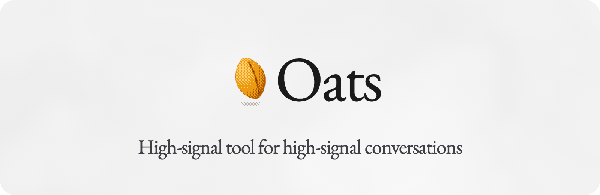
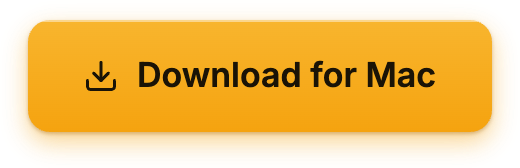
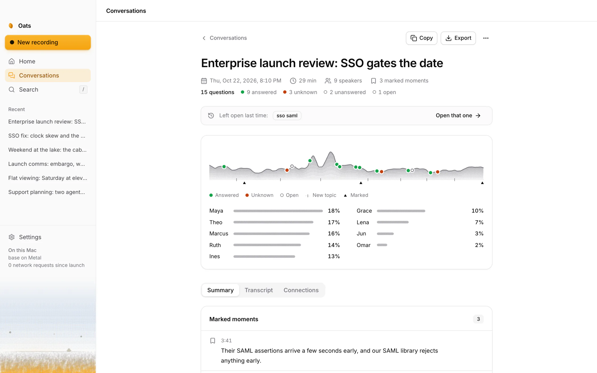
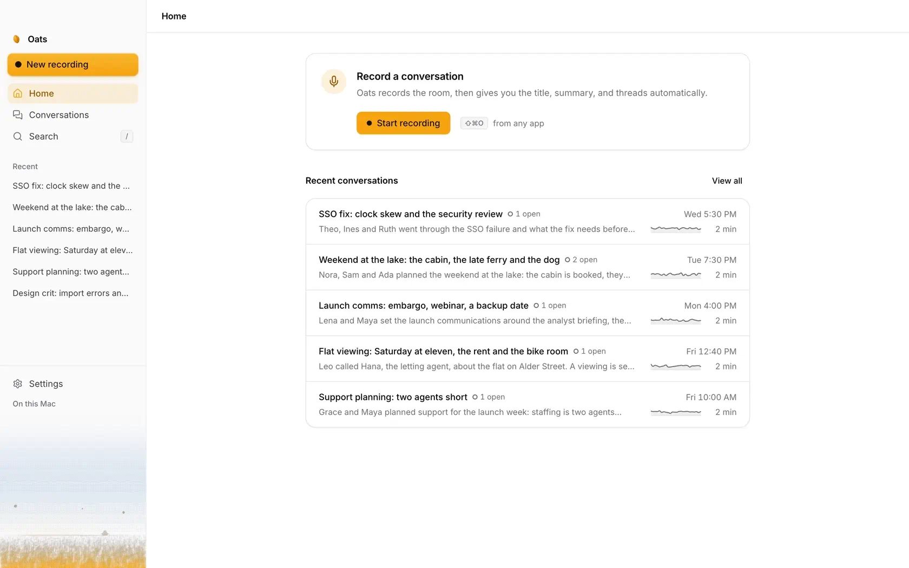
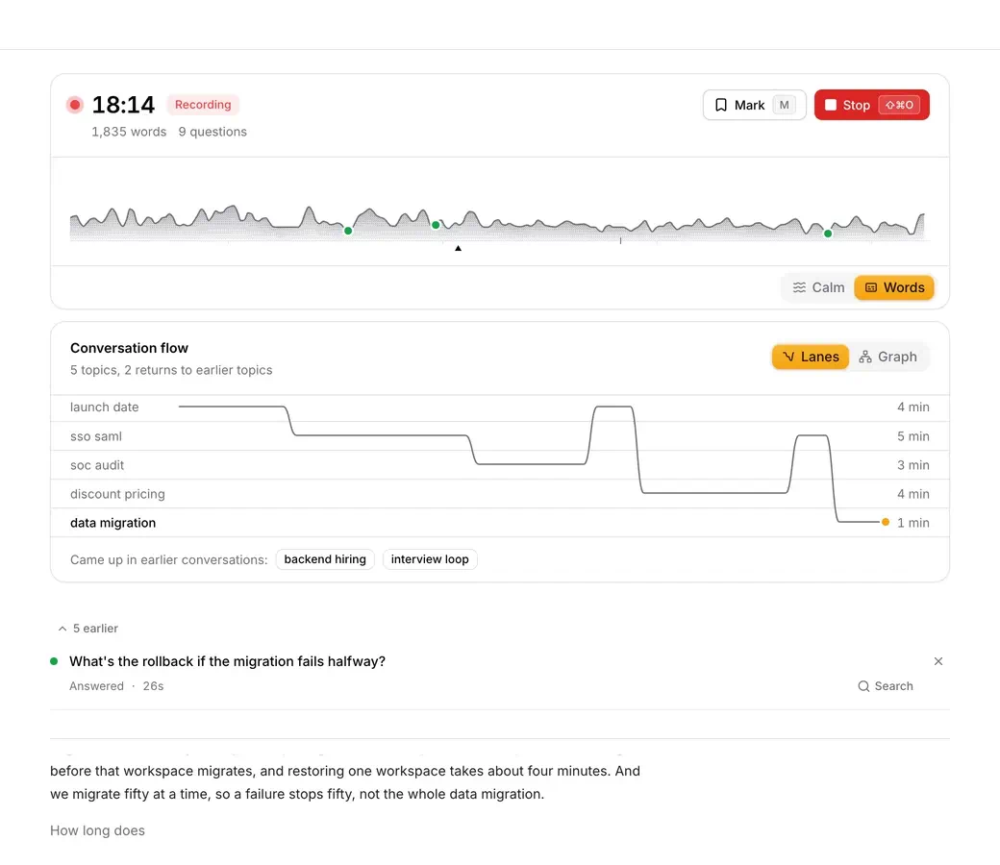
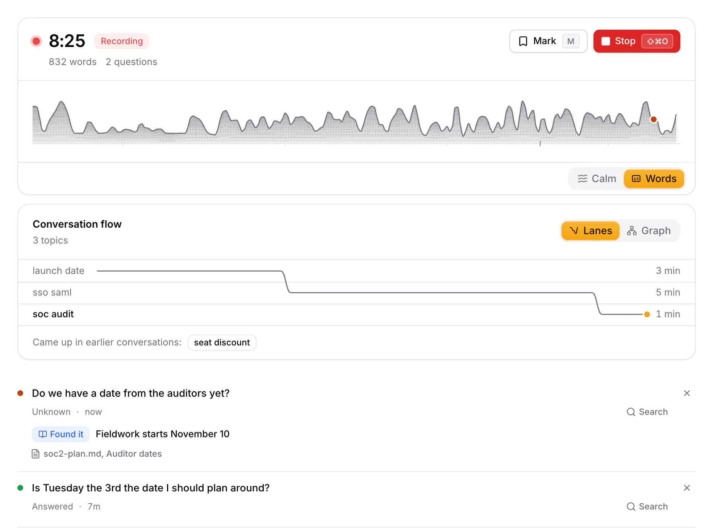
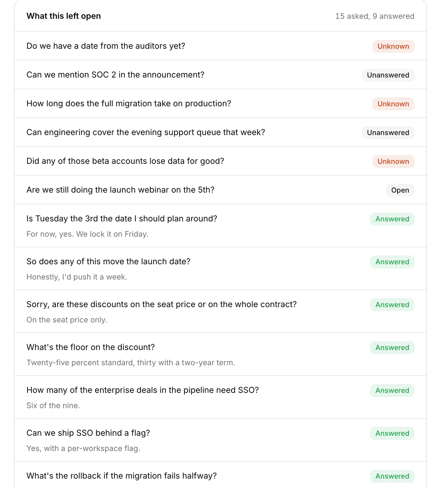
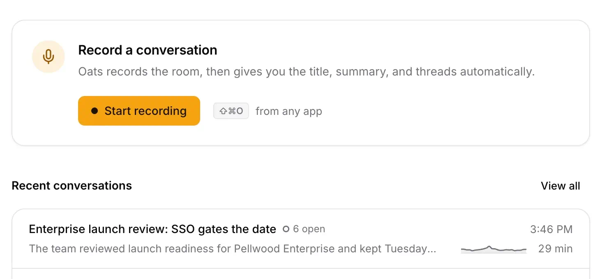
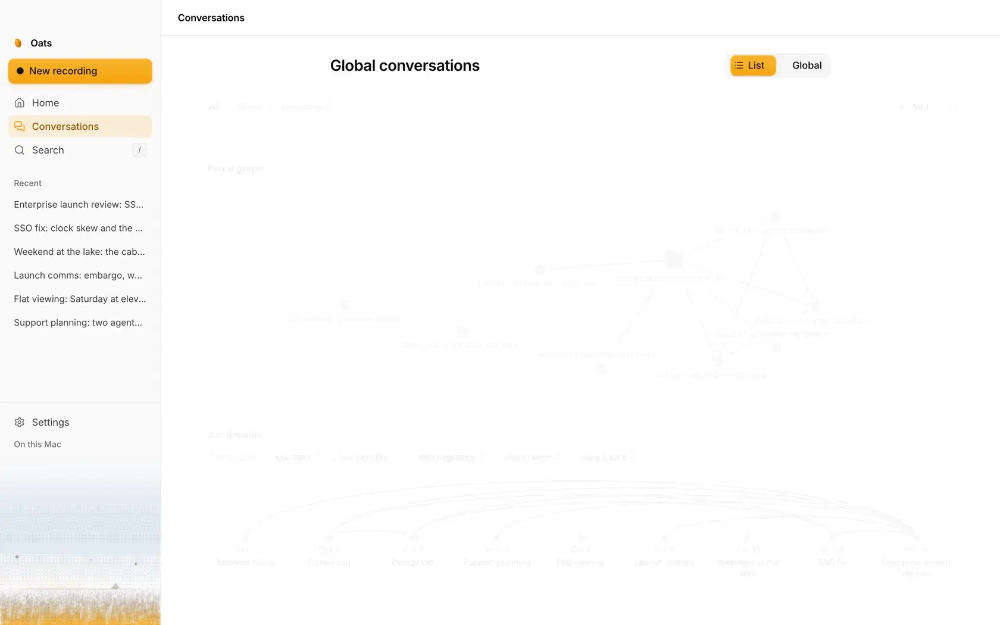
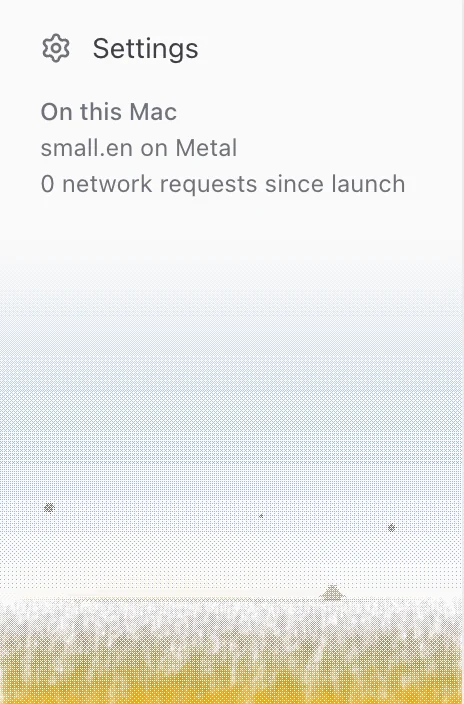

<p align="center">
  <a href="https://oats-mac.vercel.app">
    <picture>
      <source media="(prefers-color-scheme: dark)" srcset="docs/media/banner-dark.png">
      
    </picture>
  </a>
</p>

<p align="center">
  Oats records the conversation in the room and transcribes it on your Mac.<br>
  It tracks the questions people ask and whether the room answered them, checks an unsure<br>
  answer against your team's notes, and hands you the summary when you stop.
</p>

<p align="center">
  <a href="https://github.com/alexgaoth/oats/releases/latest/download/Oats-arm64.dmg"></a>
</p>

<p align="center">
  <sub>Version 0.2.0 for Apple Silicon, macOS 12 or later. Also as an <a href="https://github.com/alexgaoth/oats/releases/latest/download/Oats-x64.dmg">Intel build</a>, not yet tested on an Intel Mac.</sub><br>
  <sub><a href="https://oats-mac.vercel.app">Website</a> · <a href="https://github.com/alexgaoth/oats/releases/latest">Release notes</a></sub>
</p>

<p align="center">
  
</p>

The conversations that matter happen around a table. Taking notes pulls you out of them, and meeting bots join calls, not rooms. Oats sits on the table with one microphone. While you talk, the screen shows the shape of the conversation and nothing that competes with the people in front of you.

## What it does

### Make room for the conversation

Press <kbd>⇧</kbd><kbd>⌘</kbd><kbd>O</kbd> in any app and talk. The sidebar steps aside, and one line draws the conversation as it happens: its height is how loud the room is, a notch marks where the subject turned, and a mark shows where someone asked a question. Under the clock, two quiet counters keep the words and the questions so far. Choose **Words** to add the live transcript and the question cards.

<p align="center">
  
</p>

### Walk out knowing what is still open

Oats hears a question and watches what the room does with it. Its card says how it ended, in place, while people are still talking. A question asked twice is kept as a signal, not dropped as a repeat.

| Card | When |
|---|---|
| **Answered** | Someone gave an answer. |
| **Unknown** | The room said it did not know. Oats opens a web search for the question. |
| **Unanswered** | The room moved on. |
| **Open** | Nobody has replied yet. |

<p align="center">
  
</p>

### Checked against what your team wrote down

Turn on the context check in Settings and choose a folder of your team's notes. When an answer in the room sounds unsure, Oats finds the passage that settles it, in that folder or in your past conversations, and says so under the question: **That's right**, **Wait, that's wrong**, or **Found it** when the room did not know, with the answer and the file it came from.

Optional, and off by default: when the folder has no answer, Oats can ask Claude Code to look in GitHub, Linear and Notion, read only.

<p align="center">
  
</p>

### The conversation, given back in order

Stop, and the conversation comes back with a title, a summary and the threads it followed, talk time for each person, how each question ended, and the transcript with the speakers told apart. Titles and summaries come from a writing model on your Mac, which Oats downloads at setup, or from your own API key. The transcript, the speakers, the questions and the shape of the conversation need neither.

<p align="center">
  
</p>

### Find anything anyone said

Search reads every transcript on your Mac, including the oldest. It finds a word inside a longer one, so "rice" finds "price", and it works in Chinese and Japanese, which are written without spaces. Each search says how many matches it found and how long it took.

<p align="center">
  
</p>

### See how your conversations connect

The board lays out every conversation as a graph and as a timeline, so a subject that keeps coming back shows as the arcs between the days it came up. Each conversation is filed into Work, Personal or a group you make. A local model files it from its title, topics and summary, never from the transcript.

<p align="center">
  
</p>

## Privacy you can check



On this Mac, audio and transcripts never leave it: transcription runs on whisper.cpp with Metal, and summaries on a local model. There is no Oats account and no Oats server. With your own API key, transcripts go to your provider for summaries, and with an OpenAI key the audio goes to OpenAI for transcription.

One thing is on by default, and you can turn it off in Settings: when a question meets a clear "I don't know", Oats opens a web search for the question text in your browser.

The sidebar counts every network request since launch. Calls to the speech, writing and search servers that run on your Mac are not counted, because they never leave it. [The network allowlist](docs/network-allowlist.md) lists every destination.

<br clear="right">

## Small guarantees

- **Nothing is lost.** The transcript is saved as each sentence is finished, so a crash or a closed lid costs at most the sentence in progress. <kbd>⌘</kbd><kbd>Q</kbd> finishes and saves first.
- **A dead microphone is reported while it still matters**, not at the end.
- **A conversation that captured nothing is not saved** as a blank note.
- **Stopping and starting again within half an hour continues the same conversation**, so a coffee break does not split one meeting into two notes.
- **Every key is named where you use it:** on the button, in its tooltip, or in its menu.

## Keyboard

| Key | Action |
|---|---|
| <kbd>⇧</kbd><kbd>⌘</kbd><kbd>O</kbd> | Start or stop a conversation, from any app |
| <kbd>M</kbd> | Mark this moment |
| <kbd>⌘</kbd><kbd>\\</kbd> | Show or hide the sidebar while recording |
| <kbd>/</kbd> | Search conversations |
| <kbd>⌘</kbd><kbd>F</kbd> | Find in this conversation |
| <kbd>Esc</kbd> | Back |
| <kbd>⌘</kbd><kbd>,</kbd> | Settings |

The record shortcut can be changed in Settings.

## Install

1. Download Oats for [Apple Silicon](https://github.com/alexgaoth/oats/releases/latest/download/Oats-arm64.dmg) or [Intel](https://github.com/alexgaoth/oats/releases/latest/download/Oats-x64.dmg). It needs macOS 12 Monterey or later. The speech models ship inside, so it transcribes offline from the first launch: on Apple Silicon, Whisper `small.en` for English and multilingual `base` for every other language; on Intel, `base.en` and `base`.
2. Open the DMG and drag Oats to Applications.
3. Open Oats. This version is not notarized by Apple yet, so macOS says it cannot verify the app. Click Done.
4. Open System Settings, then Privacy & Security. Scroll down and click Open Anyway next to "Oats was blocked", and confirm with your password or Touch ID. macOS asks only once.

The SHA-256 checksums are in [SHA256SUMS.txt](https://github.com/alexgaoth/oats/releases/latest/download/SHA256SUMS.txt). On an empty Home, open the **example conversation**, a nine-person launch review, to explore everything before you record.

Tell people before you record. Some places, for example California, need everyone's consent.

## Build from source

You need Node.js 24 and the Xcode command line tools.

```sh
git clone https://github.com/alexgaoth/oats.git
cd oats
npm ci
npm run setup:check
npm run dev
```

[Developing Oats](docs/development.md) has the full setup, the Linux notes and the test suites. The public page lives in [site/](site/README.md).

## How it works

Oats is an Electron app. The interface is React. The main process runs the local speech server (whisper.cpp), an optional local language model (llama.cpp) for summaries, local embeddings for related-conversation search, and SQLite with full-text search for the transcripts. The topic tracker and the question detector are plain code over the transcript, so they cost nothing to run for an hour and never need a network. [Architecture](docs/architecture.md) maps the modules, [DESIGN.md](DESIGN.md) is the design reference, and [the product description](docs/product.md) explains each behaviour in depth.

## Principles

- **Reliable like a pencil.** It works with no network, no model and no account, it never loses a conversation, and it needs nothing explained.
- **Alive, not busy.** Nothing moves at rest. Motion answers what you did, and the recording view stays calm while people talk.
- **Honest networking.** What leaves the machine is listed, counted and switchable.

## Acknowledgements

Oats grew out of [OpenWhispr](https://github.com/OpenWhispr/openwhispr), an MIT-licensed desktop dictation app, and [UPSTREAM.md](UPSTREAM.md) records the provenance. Transcription uses [whisper.cpp](https://github.com/ggml-org/whisper.cpp), local models run on [llama.cpp](https://github.com/ggml-org/llama.cpp), the interface is set in [Inter](https://rsms.me/inter/), and the wordmark in [EB Garamond](https://github.com/octaviopardo/EBGaramond12). Topic names prefer distinctive words by their rank in English, from the Google Books Ngram corpus as counted by [google-books-ngram-frequency](https://github.com/orgtre/google-books-ngram-frequency) (CC BY 3.0). The speed check that picks the speech model for a Mac reads one utterance from [LibriSpeech](https://www.openslr.org/12) (Panayotov et al., CC BY 4.0): test-clean 7127-75946-0024, read by Bill Kneeland for LibriVox.

## License

[MIT](LICENSE)
