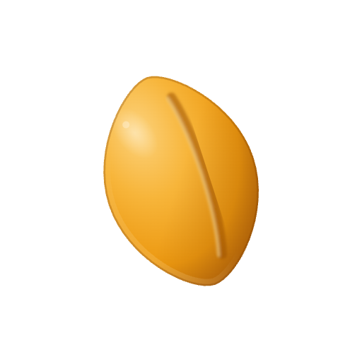
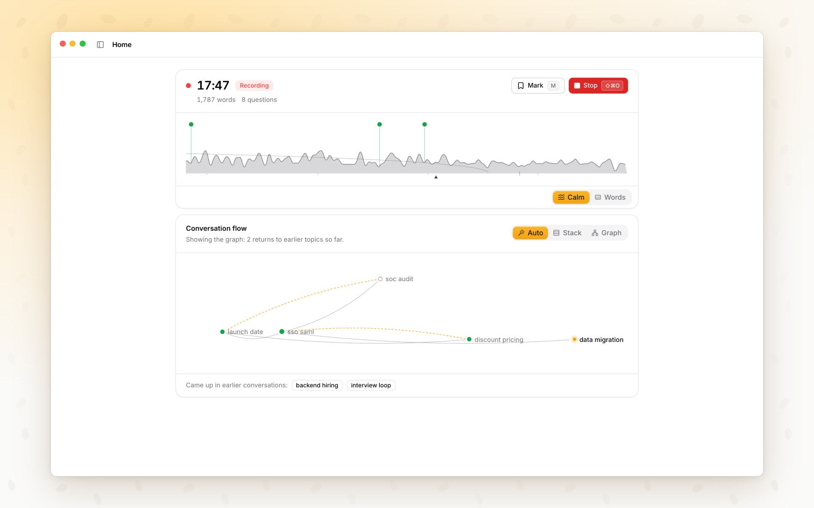
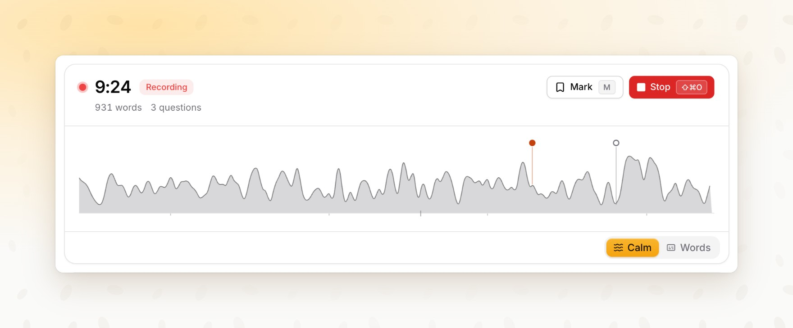
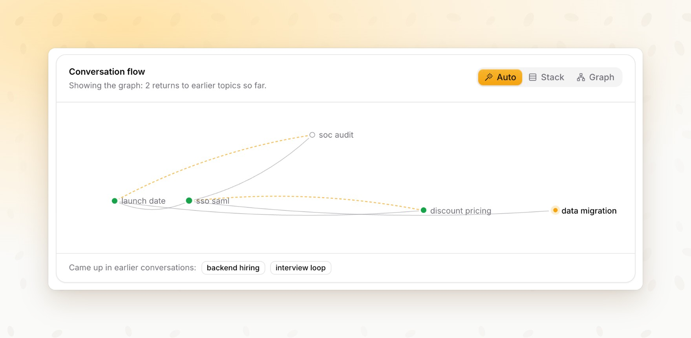
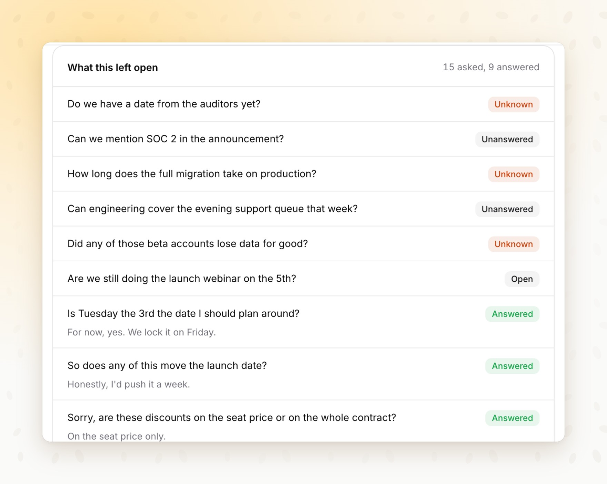
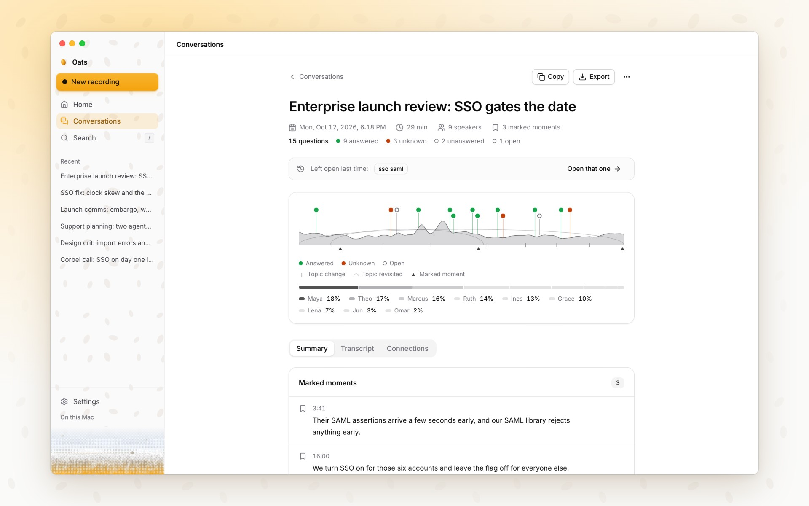
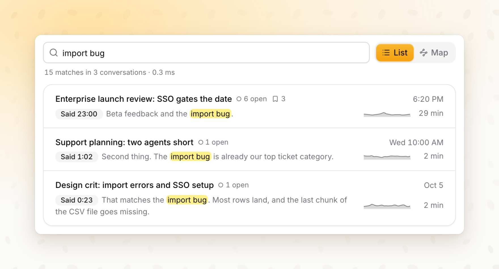
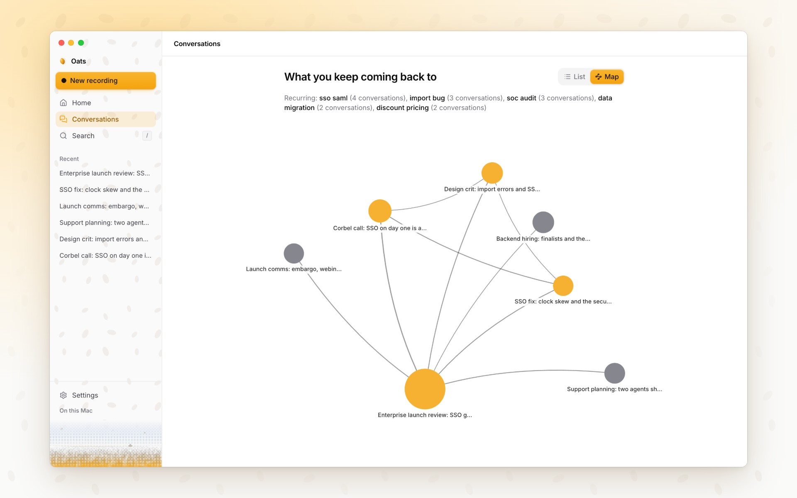

<p align="center">
  
</p>

<h1 align="center">Oats</h1>

<p align="center">
  <b>Make room for the conversation.</b><br>
  Oats records a conversation in the room, on your Mac, and stays quiet while people talk.<br>
  When you stop, it hands back the title, a summary, the threads, and every question asked.
</p>

<p align="center">
  <picture>
    <source media="(prefers-color-scheme: dark)" srcset="docs/media/hero-dark.jpg">
    
  </picture>
</p>

<p align="center">
  macOS on Apple Silicon · Linux · processed on your machine · MIT licensed
</p>

---

The conversations that matter happen around a table. Taking notes pulls you out of them, and meeting bots join calls, not rooms. Oats sits on the table with one microphone. While you talk, the screen shows the shape of the conversation and nothing that competes with the people in front of you. When you stop, it is already written up.

## What it does

### Records the room, calmly

Press **⇧⌘O** from any app. The sidebar steps aside, the record dot follows the voices, and one line draws the conversation: taller where people spoke louder, notched where the subject turned, marked wherever someone asked a question. Under the clock, two quiet counters show the words and questions so far. Choose **Words** to add the live transcript and the question cards.

<p align="center">
  <picture>
    <source media="(prefers-color-scheme: dark)" srcset="docs/media/recording-dark.jpg">
    
  </picture>
</p>

### Draws the topics as they move

Oats follows the topics from the words themselves, with no model and no network. The stack shows the topic now and the ones before it, with how long each held the room. When the room keeps coming back to a subject, **Auto** turns the stack into a graph and draws each return as a curve.

<p align="center">
  <picture>
    <source media="(prefers-color-scheme: dark)" srcset="docs/media/topics-dark.jpg">
    
  </picture>
</p>

### Catches every question

A card appears the moment someone asks a question, before anyone answers. When the reply comes, the card settles in place: **Answered**, **Unknown** when the room said it did not know, **Unanswered** when the room moved on, or still **Open**. Asking again is kept as a signal, not dropped as a repeat.

<p align="center">
  <picture>
    <source media="(prefers-color-scheme: dark)" srcset="docs/media/questions-dark.jpg">
    
  </picture>
</p>

### Writes it up when you stop

Stop, and the conversation comes back with a title, a summary, the threads that developed, how much each person spoke, every question with its outcome, and the shape of the whole conversation. The transcript is kept beside it, with the speakers told apart. The summary needs a local model or your own API key; the transcript, speakers, questions and shape need neither.

<p align="center">
  <picture>
    <source media="(prefers-color-scheme: dark)" srcset="docs/media/reading-dark.jpg">
    
  </picture>
</p>

### Finds anything anyone said

Search reads every transcript on your Mac, including the oldest. It finds a word inside a longer one, so "rice" finds "price", and it works in Chinese and Japanese, which are written without spaces. Each search says how many matches it found and how long it took.

<p align="center">
  <picture>
    <source media="(prefers-color-scheme: dark)" srcset="docs/media/search-dark.jpg">
    
  </picture>
</p>

### Shows what you keep coming back to

**Map** joins conversations that covered the same subject and names the subjects that recur, so the pattern you cannot see from inside one meeting becomes visible across all of them.

<p align="center">
  <picture>
    <source media="(prefers-color-scheme: dark)" srcset="docs/media/map-dark.jpg">
    
  </picture>
</p>

## Private by design

- **Transcription runs on your Mac**, on whisper.cpp with Metal. Summaries run on a local model, or on your own API key if you choose one. There is no Oats account and no Oats server.
- **Audio and transcripts never leave your Mac.** Topic tracking and question detection run locally, without a model call.
- **The sidebar says what has left.** Its footer reads "On this Mac", and it counts every network request since launch; no count is the normal state.
- **One thing is on by default, and you can turn it off:** when a question meets a clear "I don't know", Oats opens a web search for the question text alone, in your browser.
- **Everything else happens only when you choose it:** a model download, or an API provider you add a key for.
- Every network destination is listed in [the network allowlist](docs/network-allowlist.md).

## Small guarantees

- **Nothing is lost.** The transcript is saved as each sentence is finished, so a crash or a closed lid costs at most the sentence in progress. ⌘Q finishes and saves first.
- **A dead microphone is reported while it still matters**, not at the end.
- **A conversation that captured nothing is not saved** as a blank note.
- **Stopping and starting again within half an hour continues the same conversation**, so a coffee break does not split one meeting into two notes.
- **Every key is named where you use it:** on the button, in its tooltip, or in its menu.

## Keyboard

| Key | Action |
|---|---|
| <kbd>⇧</kbd><kbd>⌘</kbd><kbd>O</kbd> | Start or stop a conversation, from any app |
| <kbd>M</kbd> | Mark this moment |
| <kbd>⌘</kbd><kbd>\\</kbd> | Show or hide the sidebar while recording |
| <kbd>/</kbd> | Search conversations |
| <kbd>⌘</kbd><kbd>F</kbd> | Find in this conversation |
| <kbd>Esc</kbd> | Back |
| <kbd>⌘</kbd><kbd>,</kbd> | Settings |

The record shortcut can be changed in Settings.

## Try it

There is no signed download yet, so Oats runs from source. You need an Apple Silicon Mac (or Linux), Node.js 24 and the Xcode command line tools.

```sh
git clone https://github.com/alexgaoth/oats.git
cd oats
npm ci
npm run setup:check
npm run dev
```

On an empty Home, open the **example conversation**: a nine-person launch review with a busy topic graph and real questions, so you can explore everything before you record anything. To fill a development profile with more sample conversations, run `npm run seed:sample`. [Developing Oats](docs/development.md) has the full setup, Linux notes and the test suites.

## How it works

Oats is an Electron app. The interface is React; the main process runs the local speech server (whisper.cpp), an optional local language model (llama.cpp) for summaries, local embeddings for related-conversation search, and SQLite with full-text search for the transcripts. The topic tracker and the question detector are plain code over the transcript, so they cost nothing to run for an hour and never need a network. [Architecture](docs/architecture.md) maps the modules; [DESIGN.md](DESIGN.md) is the design reference, and [the product description](docs/product.md) explains each behaviour in depth.

## Principles

- **Reliable like a pencil.** It works with no network, no model and no account, it never loses a conversation, and it needs nothing explained.
- **Alive, not busy.** Nothing moves at rest. Motion answers what you did, and the recording view stays calm while people talk.
- **Honest networking.** What leaves the machine is listed, counted and switchable.

## Acknowledgements

Oats grew out of [OpenWhispr](https://github.com/OpenWhispr/openwhispr), an MIT-licensed desktop dictation app; [UPSTREAM.md](UPSTREAM.md) records the provenance. Transcription uses [whisper.cpp](https://github.com/ggml-org/whisper.cpp), local models run on [llama.cpp](https://github.com/ggml-org/llama.cpp), and the interface is set in [Inter](https://rsms.me/inter/).

## License

[MIT](LICENSE)
